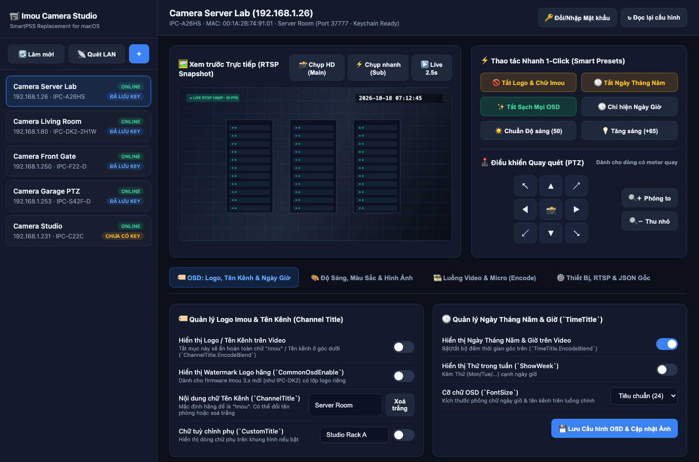
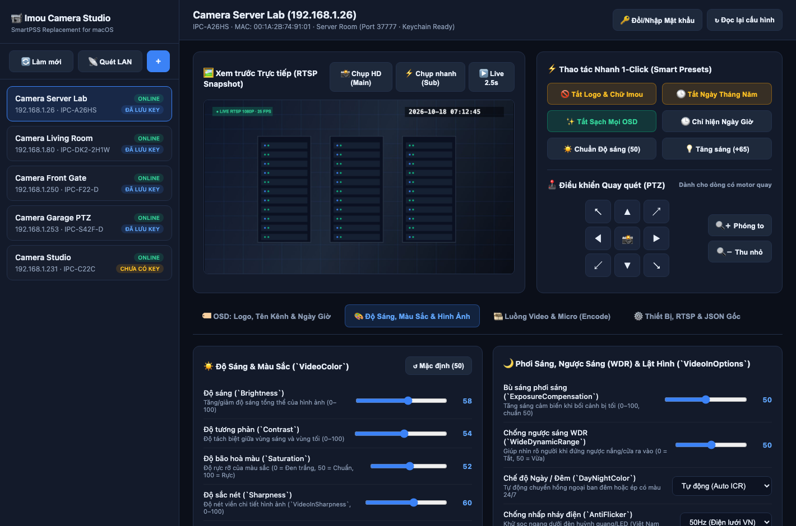
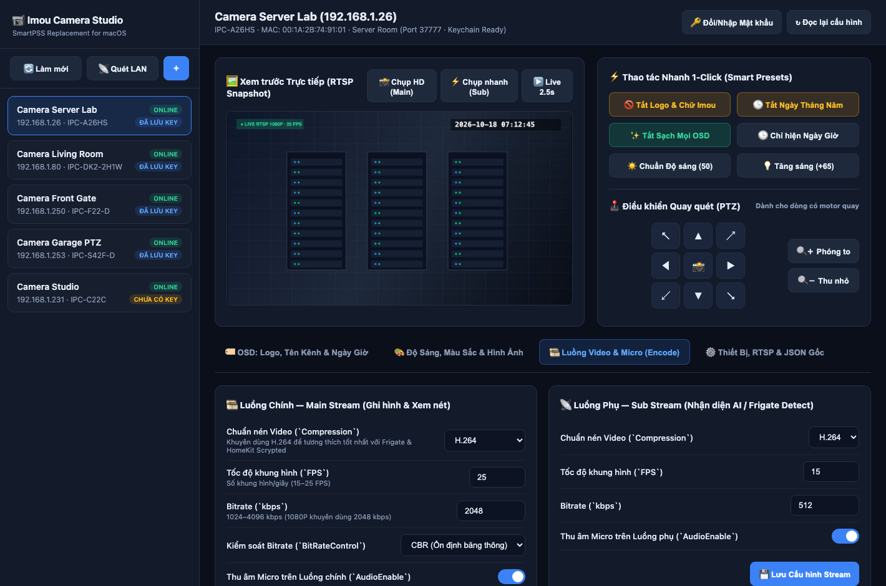
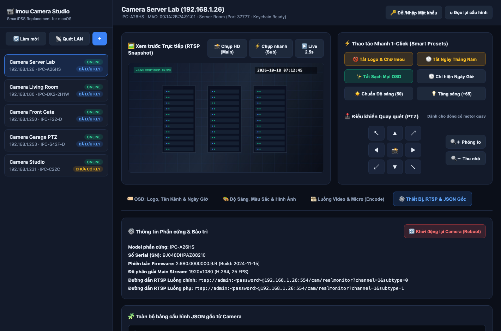
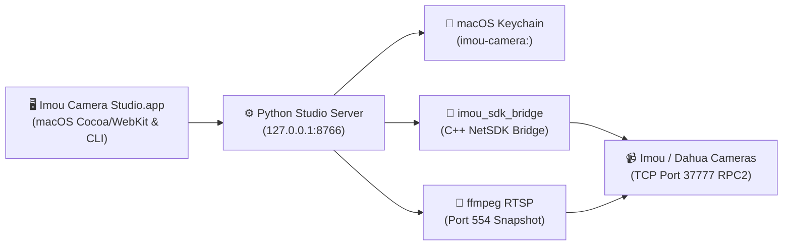

# 📹 Imou Camera Studio — SmartPSS Replacement for Modern macOS

**Imou Camera Studio** là ứng dụng macOS (Native Cocoa/WebKit Desktop App + Local Web Studio + CLI) thay thế cho phần mềm **Dahua SmartPSS** vốn đã ngừng hỗ trợ giao diện trên các phiên bản macOS mới (Apple Silicon / macOS Sequoia & Tahoe).


| Before | After |
| ------ | ----- |
|  |  |


Ứng dụng kết nối trực tiếp tới các dòng camera **Imou** và **Dahua** trong mạng nội bộ (LAN) qua giao thức gốc **TCP Port 37777 (`DVRIP` / `ROAE-128` `RPC2`)** và **RTSP (`554`)**, cho phép tuỳ chỉnh sâu các thông số phần cứng mà ứng dụng điện thoại không mở hoặc yêu cầu đám mây:
- 🚫 **Tắt/Bật hoàn toàn Logo Imou & Tên kênh (`ChannelTitle` / `CommonOsdEnable`)** trên luồng video.
- 🕒 **Tắt/Bật bộ đếm Ngày Tháng Năm & Giờ (`TimeTitle`)**, Thứ trong tuần (`ShowWeek`), đổi cỡ chữ OSD (`16`/`24`/`32`/`48`).
- ☀️ **Căn chỉnh Độ sáng (`Brightness`), Tương phản (`Contrast`), Độ bão hoà (`Saturation`), Độ sắc nét (`Sharpness`), Gamma, Bù sáng (`ExposureCompensation`), Chống ngược sáng (`WDR`)**.
- 🌙 **Tuỳ chỉnh Chế độ Ngày/Đêm (`Auto ICR` / `Full Color` / `B&W`), Chống nhấp nháy điện `50Hz/60Hz`, Lật ngược trần (`Flip`) & Đối xứng gương (`Mirror`)**.
- 🎞️ **Cấu hình Luồng Video & Âm thanh (`Encode`)**: Chuyển đổi `H.264` / `H.265`, chỉnh `FPS`, `Bitrate` (`CBR`/`VBR`), bật/tắt **Micro thu âm (`AudioEnable`)** cho cả luồng chính (Main Stream) và luồng phụ (Sub Stream — tối ưu cho **Frigate NVR**, **Scrypted HomeKit**, **Home Assistant**).
- 🕹️ **Xem trước ảnh trực tiếp (Live RTSP Snapshot) & Điều khiển quay quét PTZ 8 hướng + Zoom**.
- 🔐 **Bảo mật tuyệt đối với macOS Keychain**: Mật khẩu / Safety Code của từng camera được lưu trữ trong **macOS Keychain** (`imou-camera:<ip>`), hỗ trợ tự động giải mã & đồng bộ dữ liệu thiết bị cũ từ `SmartPSS.app` nếu có sẵn trên máy.

---

## 📸 Giao diện Ứng dụng (Screenshots)

### 1. Quản lý OSD (Tắt/Bật Logo Imou, Tên Kênh & Ngày Giờ) + Xem trước Trực tiếp & PTZ


### 2. Căn chỉnh Độ sáng, Màu sắc, Độ sắc nét, Chống ngược sáng WDR & Lật hình


### 3. Cấu hình Luồng Video (`H.264` / `H.265`, FPS, Bitrate) & Micro Thu âm


### 4. Thông tin Phần cứng, Đường dẫn RTSP & Bảng Cấu hình JSON Gốc


---

## 🏗️ Kiến trúc Hoạt động

Các dòng camera gia đình của Imou (`IPC-A26HS`, `IPC-C22C`, `IPC-F22-D`, `IPC-S42F-D`, `IPC-DK2`, `IPC-TA32CP`...) thường khóa giao diện web HTTP cổng `80`, nhưng vẫn mở cổng quản trị nhị phân **TCP `37777`** chuẩn Dahua (`DVRIP` kết hợp mã hoá phiên `ROAE-128` + `RSA` cho các lệnh `RPC2` JSON).



---

## 🚀 Cài đặt & Khởi chạy Nhanh

### Yêu cầu hệ thống
- **macOS 14.0+** (Apple Silicon `M1/M2/M3/M4` với Rosetta 2 hoặc Intel).
- Có bộ thư viện `Frameworks` từ `/Applications/SmartPSS.app/Contents/Frameworks` (`libdhnetsdk.so`, `libSPSSLogic.dylib`).
- `ffmpeg` (để chụp ảnh xem trước trực tiếp từ luồng RTSP): `brew install ffmpeg`.

### 1. Build và cài đặt ứng dụng vào `/Applications`
```bash
git clone https://github.com/leolionart/imou-camera-studio.git
cd imou-camera-studio

# Biên dịch C++ SDK Bridge và đóng gói ứng dụng macOS vào /Applications/Imou Camera Studio.app
make install

# Mở ứng dụng ngay
make run
```

Sau khi cài đặt, bạn có thể mở **Imou Camera Studio** trực tiếp từ **Applications / Spotlight / Launchpad** hoặc truy cập địa chỉ `http://127.0.0.1:8766`.

---

## 💻 Sử dụng qua Giao diện Dòng lệnh (CLI)

Ngoài giao diện đồ hoạ, toàn bộ tính năng đều có thể điều khiển qua `scripts/imou_cli.py` (tương thích hoàn toàn với các AI Agent như Claude Code, Codex, Gemini):

### 1. Quét tự động các camera Imou/Dahua trong mạng LAN (Port 37777)
```bash
# Kiểm tra danh sách camera đã lưu
python3 scripts/imou_cli.py discover

# Quét toàn bộ dải mạng LAN hiện tại trên cổng 37777
python3 scripts/imou_cli.py discover --scan-all
```

### 2. Đồng bộ tự động mật khẩu cũ từ `SmartPSS.app` sang macOS Keychain
```bash
python3 scripts/imou_cli.py import-smartpss
```

### 3. Lưu mật khẩu (hoặc mã Safety Code 8 ký tự dưới đáy camera) vào Keychain
```bash
printf '%s' "YOUR_SAFETY_CODE" | python3 scripts/imou_cli.py set-password --ip 192.168.1.26 --stdin
```

### 4. Đọc toàn bộ thông số OSD, Độ sáng, Màu sắc, Luồng Encode của Camera
```bash
python3 scripts/imou_cli.py inspect --ip 192.168.1.26
```

### 5. Tắt/Bật Logo Imou & Ngày Tháng Năm (OSD)
```bash
# Tắt logo Imou, xoá chữ "Imou", giữ lại ngày giờ:
python3 scripts/imou_cli.py set-osd --ip 192.168.1.26 --logo off --clear-title

# Tắt ngày tháng năm:
python3 scripts/imou_cli.py set-osd --ip 192.168.1.26 --time off

# Tắt sạch mọi OSD (Clean feed cho Frigate / HomeKit):
python3 scripts/imou_cli.py set-osd --ip 192.168.1.26 --logo off --time off --clear-title
```

### 6. Căn chỉnh Độ sáng, Tương phản, Độ sắc nét, WDR, Lật hình
```bash
python3 scripts/imou_cli.py set-image \
  --ip 192.168.1.26 \
  --brightness 60 \
  --contrast 55 \
  --saturation 50 \
  --sharpness 60 \
  --wdr 50 \
  --mirror off \
  --flip off
```

### 7. Cấu hình Chuẩn nén `H.264`/`H.265`, FPS, Bitrate & Micro
```bash
python3 scripts/imou_cli.py set-encode \
  --ip 192.168.1.26 \
  --main-codec H.264 \
  --main-fps 25 \
  --main-bitrate 2048 \
  --main-audio on
```

### 8. Điều khiển quay quét PTZ & Chụp ảnh Snapshot RTSP
```bash
python3 scripts/imou_cli.py ptz --ip 192.168.1.26 --action left --speed 4 --duration-ms 400
python3 scripts/imou_cli.py snapshot --ip 192.168.1.26 --output /tmp/snapshot.jpg
```

---

## 📂 Cấu trúc Dự án

```text
imou-camera-studio/
├── Makefile                        # Build SDK bridge & đóng gói ứng dụng macOS (.app)
├── src/
│   └── ImouCameraStudio.m          # Mã nguồn ứng dụng cửa sổ macOS Native (Cocoa + WebKit)
├── scripts/
│   ├── imou_sdk_bridge.cpp         # Cầu nối C++ tốc độ cao tới Dahua NetSDK & giải mã SmartPSS
│   ├── imou_cli.py                 # Thư viện lõi & công cụ dòng lệnh (CLI)
│   ├── imou_web_server.py          # Local HTTP API & Studio Server (127.0.0.1:8766)
│   └── start_studio.sh             # Script quản lý tiến trình (start / stop / status / open)
├── assets/
│   ├── index.html                  # Giao diện điều khiển Imou Camera Studio
│   └── cameras.json                # File mẫu danh sách camera (dữ liệu cá nhân lưu tại ~/.config/imou-camera-studio/cameras.json)
└── docs/
    ├── api_reference.md            # Tài liệu đặc tả các bảng cấu hình RPC2 (Firmware 2.x & 3.x)
    └── screenshots/                # Hình ảnh giao diện ứng dụng
```

---

## 🔒 Quy tắc Bảo mật & Quyền riêng tư
- **Không lưu mật khẩu dạng văn bản thuần (Plaintext)**: Mọi mật khẩu thiết bị đều được cất trong **macOS Keychain** (`security add-generic-password -s "imou-camera:<ip>"`).
- **Tách biệt danh sách thiết bị cá nhân**: Khi bạn thêm hoặc chỉnh sửa camera trên giao diện, danh sách IP/MAC của bạn được lưu riêng tại `~/.config/imou-camera-studio/cameras.json` (nằm ngoài thư mục Git).

---

## 📄 License
Phát hành dưới giấy phép [MIT License](LICENSE).
